<div align="center">

<p align="center">
  
</p>

# 🌐 Awesome 3D Scene Reconstruction & Computer Vision

<p align="center">
  <strong>Curated Directory of Industry-Leading SaaS Platforms &amp; Open-Source Repositories</strong><br>
  <em>Structure-from-Motion (SfM) • Multi-View Stereo (MVS) • 3D Gaussian Splatting (3DGS) • Neural Radiance Fields (NeRF) • Foundation 3D Models</em>
</p>

<p align="center">
  <a href="https://github.com/ishandutta2007/Awesome-Awesome-Awesome"></a>
  <a href="https://discord.gg/jc4xtF58Ve"></a>
  <a href="https://github.com/ishandutta2007/Awesome-3D-Scene-Reconstruction-Computer-Vision/stargazers"></a>
  <a href="https://github.com/ishandutta2007/Awesome-3D-Scene-Reconstruction-Computer-Vision/network/members"></a>
  <a href="https://github.com/ishandutta2007"></a>
</p>

<p align="center">
  <strong>Updated: November 2026</strong> • Contributions &amp; Submissions Welcome ✨
</p>

---

</div>

## 📖 Overview & Ecosystem Scope

Welcome to **Awesome 3D Scene Reconstruction & Computer Vision** — a comprehensive, SEO-optimized directory tracking the most potent **commercial SaaS platforms** and **open-source GitHub repositories** powering 3D scene capture, spatial computing, and digital twin reconstruction.

From classical multi-view geometry (Structure-from-Motion, Multi-View Stereo, point cloud meshing) to modern neural representations (**3D Gaussian Splatting**, **NeRF**, and **foundation feed-forward geometry models** like VGGT and DUSt3R), these tools enable engineers, researchers, and creators to convert uncalibrated photographs, drone flights, LiDAR scans, or casual mobile videos into metric 3D assets, navigable virtual scenes, and interactive WebGL environments.

---

## 📑 Table of Contents

- [📊 Sector Overview & Market Dynamics](#-sector-overview--market-dynamics)
- [☁️ SaaS & Commercial Hosted Platforms](#️-saas--commercial-hosted-platforms)
- [🚀 Top Open-Source GitHub Projects (Ranked by Stars)](#-top-open-source-github-projects-ranked-by-stars)
- [🛠️ Recommended System Architecture Pipeline](#️-recommended-system-architecture-pipeline)
- [🤝 How to Contribute](#-how-to-contribute)
- [💖 Support & Community](#-support--community)
- [⭐ Star History](#-star-history)
- [⚠️ Disclaimer](#️-disclaimer)

---

## 📊 Sector Overview & Market Dynamics

The global **3D reconstruction and computer vision spatial mapping sector** is estimated at **$1.6B–$1.9B**, projected to surpass **$3.2B by the early 2030s** at a **11%–17% CAGR**. 

Rather than a "winner-take-all" monopoly, the sector exhibits **moderate to high market fragmentation** across distinct vertical domains:
- 🏗️ **Architecture, Engineering & BIM / Digital Twins** (Matterport, Procore/DroneDeploy)
- 🛰️ **Geospatial & Drone Aerial Surveying** (Pix4Dcloud, Agisoft Metashape, OpenDroneMap)
- 🔬 **High-Precision Industrial Metrology & CAD Inspection** (Artec 3D, MeshLab, CloudCompare)
- 🎮 **VFX, Gaming & Virtual Production** (Epic Games RealityCapture, Unreal Engine)
- 📱 **Mobile Spatial AI & Radiance Fields** (Niantic Scaniverse, Luma AI, Polycam, KIRI Engine)

The technological frontier is currently defined by a paradigm shift: traditional, compute-heavy iterative optimization (SfM + MVS) is being augmented or replaced by real-time neural radiance fields (**3DGS / NeRF**) and ultra-fast **feed-forward visual geometry transformers** (`VGGT`, `DUSt3R`, `MASt3R`).

---

## ☁️ SaaS & Commercial Hosted Platforms

*Ranked by Company Scale (Valuation / Revenue, Descending).*

| Platform 🏢 | Company Scale 📈 | Description 📝 | Pricing 💳 | Free Tier / Free Trial Limits 🎁 |
| :--- | :--- | :--- | :--- | :--- |
| **[Epic Games RealityCapture](https://capturingreality.com)** | **$22.5B Valuation** (~$5B+ annual revenue) | Industry-standard photogrammetry & laser-scanning reconstruction software producing ultra-high-resolution textured 3D meshes and ortho-projections. | Free for revenue <$1M/yr; **$1,250/seat/year** for enterprise (or $1,850/yr Unreal bundle) | **Free forever** for all individuals, students, educators, and businesses with gross annual revenue under $1,000,000 USD (full features). |
| **[Niantic Scaniverse](https://scaniverse.com)** | **$3.5B Unit Valuation** (historic $9B valuation, ~$650M–$700M peak revenue) | Mobile spatial capture app offering fast on-device 3D Gaussian Splatting, LiDAR scanning, and cloud rendering for geospatial world mapping. | Paid cloud plans start at **$20/month** (Plus, or $200/yr) up to $50/mo (Pro) | **Free forever** for unlimited on-device captures, Gaussian splat processing, and mesh exports (SPZ, FBX, PLY); includes 20,000 free monthly cloud credits. |
| **[Luma AI](https://lumalabs.ai)** | **$4.0B Valuation** (~$900M Series C, tens of millions ARR) | Cloud AI 3D capture and radiance field platform converting mobile video into photorealistic 3D Gaussian Splats, textured meshes, and interactive WebGL scenes. | Paid subscription plans start at **$30/month** (Plus, or $25/mo billed annually) | **Free forever** basic tier with limited daily regeneration credits (~30 video/capture generations, non-commercial/watermarked). |
| **[Matterport](https://matterport.com)** | **$1.6B Valuation / Mkt Cap** (Nasdaq: MTTR, ~$170M annual revenue) | Enterprise spatial data and digital twin SaaS transforming 360 cameras, LiDAR scanners, and smartphones into navigable 3D virtual tours and BIM files. | Paid self-serve plans start at **$108/month** (Professional tier, or $90/mo billed annually) | **Free forever** plan limited to 1 active space/digital twin at a time, 1 user, smartphone/360-camera capture only (no Matterport Pro cameras). |
| **[DroneDeploy](https://dronedeploy.com)** | **$845M Acquisition Valuation** (Acquired by Procore; ~$78M annual revenue) | Enterprise drone reality capture and site intelligence platform automating aerial and 360-camera 3D reconstruction for construction and surveying. | Paid self-serve plans start at **$159/month** (Ag-Lite, billed annually) or $329/mo (Individual) | **14-day free trial** with full platform exploration, flight planning, and 2D/3D map generation capabilities (no credit card required). |
| **[Pix4Dcloud](https://pix4d.com)** | **$25M Valuation** (~$14M–$30M annual revenue) | Cloud photogrammetry and drone mapping SaaS converting aerial/terrestrial imagery into measurable 3D meshes, point clouds, and CAD overlays. | Paid plans start at **$129/month** (Pix4Dcloud Starter, or $107.50/mo billed annually); Pro at $449/mo | **15-day free trial** with full PIX4Dcloud Pro features, including an allocation of 40 processing credits (~200 images at 20 MP; trial data expires after 30 days). |
| **[Artec Cloud](https://artec3d.com)** | **$25M–$30M Annual Revenue** (Privately held, backed by European Investment Bank) | Cloud 3D scan processing, point-cloud registration, mesh reconstruction, and collaborative browser inspection for precision industrial 3D scanners. | Paid storage tiers start at **$70/month** (200 GB, or $59/mo billed annually) | **Free forever** entry plan providing 5 GB of cloud storage for viewing, commenting, and project backup. |
| **[Polycam](https://poly.cam)** | **$6.5M Annual Revenue** (Venture-backed Series A) | Cross-platform mobile and web 3D scanning suite supporting cloud photogrammetry, LiDAR capture, 3D Gaussian Splatting, and browser-native sharing. | Paid plans start at **$30/month** (Polycam Basic, or ~$150/year billed annually); Business from $25/seat/mo | **Free forever** plan for basic mobile capture and viewing; advanced CAD/BIM/point-cloud exports and unlimited splat processing require paid tiers. |
| **[Agisoft Metashape Cloud](https://agisoft.com)** | **$3M–$4M Annual Revenue** (Privately held / bootstrapped) | Cloud photogrammetric processing pipeline and storage backend for Metashape Professional producing dense point clouds and georeferenced DEMs. | Commercial storage starts at **$10/month** for 100 GB (plus pay-per-use processing at $4.25/compute hour) | **Free plan** providing 50 GB cloud storage and 20 compute hours per month renewed monthly (available for trial, Metashape Pro trial, and educational users). |
| **[KIRI Engine](https://kiriengine.app)** | **Bootstrap / Seed Stage** (<$3M estimated revenue) | Cloud 3D scanning and Gaussian Splatting app offering photo-to-3D reconstruction, featureless object scanning, quad-retopology, and Blender integration. | Pro subscription starts at **$79.99/year** (~$6.66/month equivalent) or $17.99 month-to-month | **Free forever** plan with unlimited free exports (OBJ, FBX, STL, GLB/GLTF, USDZ) and unlimited LiDAR scans, capped at 150 photos (2 GB) per photogrammetry scan. |

---

## 🚀 Top Open-Source GitHub Projects (Ranked by Stars)

*Every repository includes a live GitHub star badge (with `style=social` and `color=white`) linking directly to its GitHub stargazers page. Sorted strictly by star count in descending order.*

1. **[graphdeco-inria/gaussian-splatting](https://github.com/graphdeco-inria/gaussian-splatting)** [](https://github.com/graphdeco-inria/gaussian-splatting/stargazers)  
   *Reference SIGGRAPH 2023 CUDA implementation for real-time 3D scene reconstruction and radiance field rendering using 3D Gaussian Splatting.*  
   `License: Custom Research / Inria` • `Domain: 3DGS, Radiance Fields`

2. **[NVlabs/instant-ngp](https://github.com/NVlabs/instant-ngp)** [](https://github.com/NVlabs/instant-ngp/stargazers)  
   *NVIDIA's breakthrough multiresolution hash-encoding framework for instant neural radiance fields (NeRF), gigapixel images, and signed distance functions (SDF).*  
   `License: Custom NVIDIA Research` • `Domain: NeRF, Instant Training`

3. **[facebookresearch/vggt](https://github.com/facebookresearch/vggt)** [](https://github.com/facebookresearch/vggt/stargazers)  
   *CVPR 2025 Best Paper. Meta AI's Visual Geometry Grounded Transformer directly inferring camera poses, depth maps, dense pointmaps, and 3D point tracks from 1 to 100+ uncalibrated views in seconds.*  
   `License: CC-BY-NC 4.0` • `Domain: Foundation Geometry Transformer`

4. **[isl-org/Open3D](https://github.com/isl-org/Open3D)** [](https://github.com/isl-org/Open3D/stargazers)  
   *Comprehensive open-source C++ and Python library for 3D data processing, RGB-D odometry, TSDF volumetric integration, point cloud registration, and Poisson surface reconstruction.*  
   `License: MIT` • `Domain: 3D Point Cloud & Mesh Library`

5. **[colmap/colmap](https://github.com/colmap/colmap)** [](https://github.com/colmap/colmap/stargazers)  
   *Industry-standard general-purpose Structure-from-Motion (SfM) and Multi-View Stereo (MVS) pipeline powering camera registration across photogrammetry and NeRF/3DGS research.*  
   `License: BSD-3-Clause` • `Domain: SfM / MVS Reconstruction`

6. **[alicevision/meshroom](https://github.com/alicevision/meshroom)** [](https://github.com/alicevision/meshroom/stargazers) [](https://github.com/alicevision/meshroom/stargazers)  
   *Full-featured node-based visual photogrammetry workbench built on the AliceVision computer vision framework for end-to-end photo-to-textured-mesh reconstruction.*  
   `License: MPL-2.0` • `Domain: Node-based Photogrammetry`

7. **[nerfstudio-project/nerfstudio](https://github.com/nerfstudio-project/nerfstudio)** [](https://github.com/nerfstudio-project/nerfstudio/stargazers)  
   *Modular, production-ready PyTorch framework unifying 3D Gaussian Splatting (`splatfacto`), NeRFs (`nerfacto`), COLMAP integration, and an interactive real-time web visualizer.*  
   `License: Apache-2.0` • `Domain: NeRF & 3DGS Framework`

8. **[DepthAnything/Depth-Anything-V2](https://github.com/DepthAnything/Depth-Anything-V2)** [](https://github.com/DepthAnything/Depth-Anything-V2/stargazers)  
   *State-of-the-art monocular depth estimation foundation model producing ultra-detailed, metric-aligned depth maps for monocular 3D scene lifting and video reconstruction.*  
   `License: Apache-2.0` • `Domain: Monocular Depth Foundation`

9. **[naver/dust3r](https://github.com/naver/dust3r)** [](https://github.com/naver/dust3r/stargazers)  
   *Geometric 3D vision breakthrough from NAVER Labs Europe reconstructing metric 3D pointmaps and pixel correspondences from uncalibrated image pairs without camera intrinsics or prior SfM.*  
   `License: CC-BY-NC-SA 4.0` • `Domain: Feed-Forward Dense 3D Pointmaps`

10. **[OpenDroneMap/ODM](https://github.com/OpenDroneMap/ODM)** [](https://github.com/OpenDroneMap/ODM/stargazers)  
    *Production-grade drone and aerial mapping engine generating georeferenced orthophotos, digital surface models (DSM/DEM), dense point clouds, and 3D textured meshes via CLI and WebODM.*  
    `License: AGPL-3.0` • `Domain: Aerial & Drone Photogrammetry`

11. **[openMVG/openMVG](https://github.com/openMVG/openMVG)** [](https://github.com/openMVG/openMVG/stargazers)  
    *Modular C++ computer vision library specializing in robust multiple view geometry, epipolar geometry solvers, and global/incremental Structure-from-Motion.*  
    `License: MPL-2.0` • `Domain: Multiple View Geometry / SfM`

12. **[cnr-isti-vclab/meshlab](https://github.com/cnr-isti-vclab/meshlab)** [](https://github.com/cnr-isti-vclab/meshlab/stargazers)  
    *Widely deployed open-source system for processing, cleaning, filtering, remeshing, inspecting, rendering, and converting large unstructured 3D triangular meshes and point clouds.*  
    `License: GPL-3.0` • `Domain: Mesh Processing & Filtering`

13. **[nerfstudio-project/gsplat](https://github.com/nerfstudio-project/gsplat)** [](https://github.com/nerfstudio-project/gsplat/stargazers)  
    *High-performance CUDA/C++ library with PyTorch bindings for real-time 3D Gaussian Splatting rasterization, featuring fast forward/backward passes and memory-efficient training.*  
    `License: Apache-2.0` • `Domain: 3DGS Rasterization Core`

14. **[apple/ml-depth-pro](https://github.com/apple/ml-depth-pro)** [](https://github.com/apple/ml-depth-pro/stargazers)  
    *Apple's zero-shot metric monocular depth estimation foundation model generating high-resolution depth maps and focal lengths from single arbitrary images in under 1 second.*  
    `License: Apple Sample Code / Non-Commercial` • `Domain: Zero-shot Metric Depth`

15. **[CloudCompare/CloudCompare](https://github.com/CloudCompare/CloudCompare)** [](https://github.com/CloudCompare/CloudCompare/stargazers)  
    *Industry-standard 3D point cloud processing software featuring advanced ICP alignment, cloud-to-cloud/cloud-to-mesh geometric comparison, registration, and segmentation.*  
    `License: GPL-2.0` • `Domain: Point Cloud Registration & Inspection`

16. **[cdcseacave/openMVS](https://github.com/cdcseacave/openMVS)** [](https://github.com/cdcseacave/openMVS/stargazers)  
    *Complete Multi-View Stereo library taking calibrated camera poses (from COLMAP/OpenMVG) and executing dense point-cloud generation, mesh reconstruction, mesh refinement, and texture baking.*  
    `License: AGPL-3.0` • `Domain: Dense MVS & Texture Mesh`

17. **[introlab/rtabmap](https://github.com/introlab/rtabmap)** [](https://github.com/introlab/rtabmap/stargazers)  
    *Real-Time Appearance-Based 3D Mapping RGB-D, Stereo and LiDAR Graph-Based SLAM engine with memory management for large-scale long-term online 3D spatial mapping.*  
    `License: BSD-3-Clause` • `Domain: RGB-D / LiDAR SLAM`

18. **[hbb1/2d-gaussian-splatting](https://github.com/hbb1/2d-gaussian-splatting)** [](https://github.com/hbb1/2d-gaussian-splatting/stargazers)  
    *SIGGRAPH 2024 surface reconstruction method utilizing 2D planar Gaussian disks to deliver accurate, watertight geometric surface extraction and high-fidelity rendering.*  
    `License: MIT` • `Domain: 2D Gaussian Surface Reconstruction`

19. **[naver/mast3r](https://github.com/naver/mast3r)** [](https://github.com/naver/mast3r/stargazers)  
    *Matching and Stereo 3D Reconstruction model building upon DUSt3R to produce dense local feature tracks, robust pairwise matching, and fast metric camera pose estimation.*  
    `License: CC-BY-NC-SA 4.0` • `Domain: Dense Feature Matching & Geometry`

20. **[colmap/glomap](https://github.com/colmap/glomap)** [](https://github.com/colmap/glomap/stargazers)  
    *ECCV 2024 global Structure-from-Motion mapper integrated with COLMAP that solves camera positions and orientations simultaneously, running orders of magnitude faster than incremental SfM.*  
    `License: BSD-3-Clause` • `Domain: Global Structure-from-Motion`

21. **[spla-tam/SplaTAM](https://github.com/spla-tam/SplaTAM)** [](https://github.com/spla-tam/SplaTAM/stargazers)  
    *CVPR 2024 dense RGB-D SLAM system employing 3D Gaussian Splatting as the sole scene representation for high-fidelity real-time camera tracking and volumetric radiance mapping.*  
    `License: MIT` • `Domain: Gaussian Splatting SLAM`

22. **[muskie82/MonoGS](https://github.com/muskie82/MonoGS)** [](https://github.com/muskie82/MonoGS/stargazers)  
    *3D Gaussian Splatting SLAM from a single monocular camera feed, achieving real-time scene representation, pose tracking, and progressive reconstruction.*  
    `License: MIT` • `Domain: Monocular 3DGS SLAM`

23. **[Totoro97/NeuS](https://github.com/Totoro97/NeuS)** [](https://github.com/Totoro97/NeuS/stargazers)  
    *Seminal NeurIPS paper for Neural Implicit Surface Reconstruction using Signed Distance Functions (SDF) with volume rendering, extracting high-quality smooth geometric meshes.*  
    `License: MIT` • `Domain: Neural Implicit Surface Reconstruction`

24. **[apekshik/anyscene](https://github.com/apekshik/anyscene)** [](https://github.com/apekshik/anyscene/stargazers)  
    *Feed-forward monocular 3D scene reconstruction pipeline combining Depth Anything V2 with MASt3R dense camera matching to reconstruct colored point clouds (PLY, GLB) from arbitrary images or video.*  
    `License: MIT` • `Domain: Monocular Feed-Forward 3D Pipeline`

---

## 🛠️ Recommended System Architecture Pipeline

For practitioners designing custom computer vision & 3D reconstruction systems, here are the most effective open-source combinations:

```
[Uncalibrated Photos / Drone Video / Monocular Stream]
                         │
                         ▼
        ┌──────────────────────────────────┐
        │  Camera Pose & Geometry Matching │
        ├──────────────────────────────────┤
        │  • Fast Global: GLOMAP / COLMAP  │
        │  • Feed-Forward: VGGT / MASt3R   │
        └─────────────────┬────────────────┘
                          │
         ┌────────────────┴────────────────┐
         ▼                                 ▼
┌─────────────────────────┐     ┌─────────────────────────┐
│ Dense Surface Meshes    │     │ Radiance Fields & 3DGS  │
├─────────────────────────┤     ├─────────────────────────┤
│ • Dense MVS: OpenMVS    │     │ • Engine: Nerfstudio    │
│ • Mesh Clean: MeshLab   │     │ • Rasterizer: gsplat    │
│ • Inspection: Open3D    │     │ • Viewer: WebGL / Three │
└─────────────────────────┘     └─────────────────────────┘
```

---

## 🤝 How to Contribute

Contributions to this ecosystem are warmly welcomed! To suggest a new project, library, or platform:

1. 🍴 **Fork** this repository.
2. 🌿 Create a feature branch: `git checkout -b feature/add-new-tool`.
3. ✏️ Edit `README.md` following the established table / ranked list formats.
4. 🔗 Include: tool name, official link, 1–2 sentence description, license, and pricing/scale details.
5. 🚀 Submit a **Pull Request** with a concise description of your additions.

---

## 💖 Support & Community

If this repository has helped your research, commercial projects, or learning journey in 3D computer vision, please consider showing your support:

- ⭐ **Star this repository** to help others discover it on GitHub.
- 🍴 **Fork and share** it with colleagues, labs, and spatial computing communities.
- 💬 **Join our community** on [Discord](https://discord.gg/jc4xtF58Ve) to discuss cutting-edge 3D reconstruction, NeRFs, 3DGS, and visual geometry.
- ☕ **Support the maintainer**: Buy a coffee and support open-source maintenance via the [GitHub Sponsor Dashboard](https://github.com/sponsors/ishandutta2007).

---

## ⭐ Star History

[](https://www.star-history.com/#ishandutta2007/Awesome-3D-Scene-Reconstruction-Computer-Vision&type=date&legend=top-left)

---

## ⚠️ Disclaimer

- This curated list is maintained by the community for informational and research purposes. Inclusion does not imply official commercial endorsement.
- Neural 3D reconstruction frameworks (`Nerfstudio`, `3DGS`, `VGGT`, `Instant-NGP`) and photogrammetry packages (`COLMAP`, `OpenMVS`) require substantial GPU VRAM (NVIDIA CUDA recommended) and high-quality, overlapping multi-view input imagery for optimal metric fidelity.
